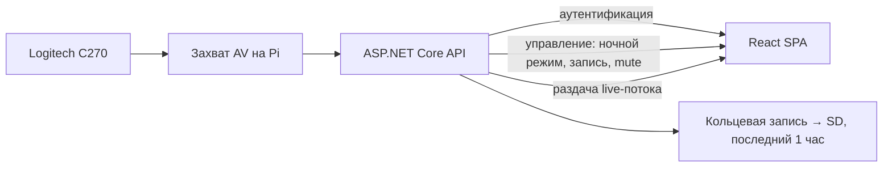

# Baby Monitor (радионяня)

Высокоуровневый дизайн домашнего сервиса мониторинга сна ребёнка на базе имеющегося железа.

## Проблема

Нужен мониторинг сна ребёнка без покупки готовых радионянь: они неудобны в повседневном использовании и не дают нужного UX.

В наличии есть Raspberry Pi 5 и веб-камера Logitech C270 — на их основе можно собрать свою радионяню.

## Цель

Собрать локальный веб-сервис (только домашняя сеть), который:

- показывает live-видео со звуком с камеры;
- даёт родителям доступ по паролю через сайт;
- позволяет включать ночной режим отображения и кольцевую запись на SD-карту;
- не требует выхода Raspberry Pi в интернет и не открывает доступ извне.

## Ограничения и допущения

- Развёртывание только дома, в локальной Wi‑Fi сети.
- Доступ из интернета **не нужен** и **не планируется** (без проброса портов, без облака, без Telegram).
- Raspberry Pi **не должен** быть доступен из интернета — это осознанное требование безопасности.
- Камера без IR: отдельную IR-камеру покупать не планируем; «ночное видение» — программная/настроечная обработка существующей C270.
- Проект домашний: приоритет — простота эксплуатации и достаточная защита в LAN.

## Стек

| Компонент | Выбор |
|---|---|
| Устройство | Raspberry Pi 5 |
| Камера | Logitech C270 (без IR) |
| Хранилище записи | SD-карта на Raspberry Pi |
| Backend | ASP.NET Core (.NET 8+) |
| Frontend | React (TypeScript) |

## Архитектура (предложение)

Всё крутится на одном Raspberry Pi в LAN.

Клиент открывает сайт по локальному адресу Pi (например `http://baby-monitor.local` / IP в LAN), вводит пароль и работает только с live-экраном.

**Вне scope:** Telegram-бот, мобильное приложение как отдельный клиент, доступ извне дома, алерты по звуку/движению, облако.

## Функциональные требования

1. **Live-трансляция** — только live-поток видео со звуком (без снапшотов/клипов как основного режима).
2. **Ночной режим** — отображение видео в режиме «ночного видения» (см. раздел ниже); включается/выключается с экрана трансляции.
3. **Веб-клиент** — единственный UI: React-сайт в локальной сети.
4. **Запись** — по запросу писать на SD-карту Pi; хранить только последний **1 час** (кольцевой буфер).
5. **Аутентификация** — пароль; без входа функционал недоступен.
6. **Ограничение доступа** — только LAN + пароль; сервис не публикуется в интернет.
7. **Управление звуком** — на экране трансляции можно отключить/включить звук потока (mute на клиенте).

## Use-cases

### UC1. Вход родителя

1. Родитель открывает сайт радионяни в домашней Wi‑Fi сети.
2. Вводит пароль.
3. При успехе получает доступ к функционалу; при ошибке — остаётся на экране входа.

### UC2. Просмотр трансляции и управление

1. После входа родитель попадает на экран с live-трансляцией (видео + звук).
2. Может **включить / выключить ночной режим**.
3. Может **включить / выключить запись** на SD (кольцо 1 час).
4. Может **отключить / включить звук** трансляции у себя на устройстве.

## Ночной режим без IR-камеры

C270 — обычная USB-камера без инфракрасной подсветки. Настоящего night vision (как у IR-радионянь) без доп. железа не будет. Цель режима — **максимально читаемая картинка в полумраке** без покупки новой камеры.

Предлагаемый подход (комбинация):

1. **Настройки захвата камеры** (предпочтительно на Pi): поднять gain/экспозицию, при необходимости снизить FPS; зафиксировать ручные параметры, чтобы автоэкспозиция не «прыгала».
2. **Обработка кадра** (сервер или клиент): grayscale + повышение контраста/яркости (лёгкий stretch / gamma) — визуально близко к «ночному» виду.
3. **Ожидания по качеству**: в полной темноте без какого-либо света картинка останется шумной или чёрной; нужен хотя бы слабый остаточный свет в комнате (ночник, щель двери). Это ограничение железа, не ПО.

Итог для продукта: переключатель «Ночной режим» применяет пресет камеры + фильтр отображения; не обещаем IR night vision.

## Нефункциональные требования

| Параметр | Целевое значение |
|---|---|
| Разрешение видео | 720p |
| Задержка (latency) | 2–4 с — приемлемо |
| Сеть | только LAN |
| Хранение записи | SD-карта, кольцо 1 час |
